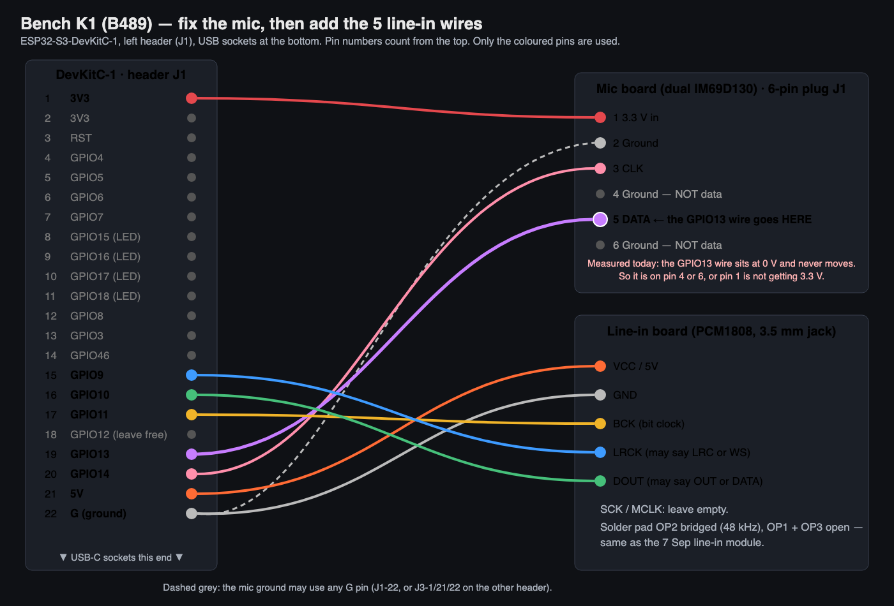

## Session 2 — bench proof on B489 (3 Nov 2026, 20:30 AWST)

Brief: charter section "Session 2 brief". Commits `1517ca17`, `6d47d9a8` (both through the full commit gate: 1928 passed, `k1_hardware` SUCCESS) plus the docs commit with this section. Nothing pushed.

### What happened, in plain English
- **The FE firmware now runs on a real chip.** On the bench K1 it starts cleanly, every start-up step passes, the light show renders at about 150 frames a second and the audio loop runs at its normal 133 a second. It correctly sees there is no FE power chip on this board and leaves the FE power pins switched off. Asked for line-in, it refuses cleanly because no line-in board is wired yet.
- **Why the bench mic "failed last time": it is the wiring, not the firmware.** The known-good bench build reads the same dead value (−30935, constant) as the October build. Both mic channels are dead. A direct pin check shows the clock wire works (it toggles), but the data wire (GPIO13) sits at 0 V even when the chip tries to pull it up, and never moves while the mics are clocked. On the mic board's 6-pin plug, the data pin (5) sits between two ground pins (4 and 6), and pin 4 used to be a signal on the older map. Measured: GPIO13 is held low and never toggles. Inferred from the mic board's documented plug map (`docs/hardware/im69d130-board-wiring-from-eda-2026-08-05.md`), not measured on the board: the data wire is on a ground pin, or the mic board is not getting 3.3 V. The same dead value is on the image running since 14 Oct, and the October debrief (`DEBRIEF_2026-10-14_B489_REFERENCE_CONTINUATION.md` §9) records it on the earlier image `eff9bf47` too.
- **Line-in is not proven yet.** The PCM1808 board is not wired. The exact five wires are drawn in the picture below.
- The board is left running the FE bench image, so the next session only has to capture.

### Steps and evidence (all in `docs/forensics/runtime-evidence/20261103-fe-bench-b489/`)
| # | Step | Result | File |
|---|---|---|---|
| 0 | Identify chip before any write | esptool: ESP32-S3, MAC `b4:3a:45:a5:89:b4` = `B489A500`, `/dev/cu.usbmodem101` | `flashlog_*.txt` (guard re-checks before and after every flash) |
| 1 | Read what was running | `f3ee66e8` `k1_b489_ws2816_reference_capture`; mic `raw_min=raw_max=-30935` | `01_before_f3ee66e8_reference_capture.txt` |
| 2 | Flash known-good `k1_bench_im69d` (brief step 1) | `IDENTITY OK git=c2928534`; `I2S PDM RX INIT: PASS slot=RIGHT`; `cal_source=persisted_profile cal_valid=1 SSL=179`; `raw_i16_rms=30935.0` constant | `02_k1_bench_im69d_known_good.txt` |
| 3 | Stereo read of both mic slots (`k1_bench_im69d_stereo`, 2 s capture, CRC checked) | RIGHT and LEFT both one value, −30935, stdev 0 | `03_…`, `scap_analysis.txt` |
| 4 | Internal pull-up on DATA (`k1_bench_im69d_wirediag_pullup`) | still −30935 on both slots | `04_…` |
| 5 | CLK/DATA swapped (`…_wirediag_swap`) | still −30935: crossed wires ruled out | `05_…` |
| 6 | Direct pin levels (`…_wirediag_pullup` @ `6d47d9a8`) | `gpio=14 pullup_reads=1 pulldown_reads=0 -> FLOATING`, `gpio=13 pullup_reads=0 pulldown_reads=0 -> HELD_LOW`; clock running: `gpio=14 ones=10006 changes=13114`, `gpio=13 ones=0 changes=0` | `06_wirediag_pin_levels_boot.txt` |
| 7 | Flash FE image `k1_fe_bench_b489` (brief step 2) | `IDENTITY OK git=6d47d9a8 env=k1_fe_bench_b489`; all INIT PASS; `[FEBOARD] stusb4500=absent … outputs=passive`; `[PCMCLK] gate=FAIL reason=NO_CLOCK`; `:audio_src=line` → `UNAVAILABLE … staying on mic`; SYSTEM_FPS 133.1, LED_FPS 149.6; `firmware.bin` SHA-256 `55c720d1…09ac` (753 216 B) | `07_k1_fe_bench_b489_boot_and_commands.txt` |
| 8 | Registry | §1 permitted envs and §2 deployed state updated; changelog line added | `docs/hardware/device-build-registry.md` |

Capture scripts used (kept with the evidence): `ser.py` (no-reset capture), `bootcap.py` (reset-and-capture), `scap.py` (stereo dump decoder, CRC-checked), `usb_reset.py` (USB re-enumeration, below).

### New envs (non-shippable, B489A500 allowlist only; shipping envs untouched)
- `k1_fe_bench_b489` = `k1_fe` + `-DK1_FE_BENCH_B489_V1` (mic CLK14/DATA13 in `constants.h`) + PCM1808 pins DOUT10/BCK11/LRCK9 as build flags. Same AP/VP maths as `k1_fe`. Builds: RAM 44.1 %, flash 11.5 %.
- `k1_bench_im69d_wirediag_pullup` / `_swap`: stereo build + pin-level readout (and pin swap). Code under `K1_IM69D_WIREDIAG_*_V1` only.
- `tests/test_im69d_env_static.py` now allows the stereo flag in the stereo probe and these two diagnostics; it still fails if any other env carries it.

### Incident (my method, recovered)
- After the first pull-up flash, my capture script's port open reset the chip and the Mac's USB link to it wedged: the port stayed listed but nothing answered, and the next flash failed (`No serial data received`). The chip was fine. A software USB re-enumeration (`usb_reset.py`, libusb reset of VID 0x303A / PID 0x1001) brought it back with no physical action; esptool then read the MAC and the flash was repeated. The failed attempt's log was overwritten by the successful retry.

### Could NOT be proven this session (named, not claimed)
- **Line-in on silicon (PCM1808 classifier PASS):** the module is not wired. Needs the five wires in the picture.
- **Mic path CAL/RMS in range on the FE image:** blocked by the bench mic wiring fault. Needs the mic DATA wire fixed.
- **Web flasher flashing a K1 in ≤3 clicks:** not attempted. The page has only the `k1_fe` variant, which is not allowed on B489 (wrong pin map), and driving the Captain's real Chrome is blocked by the desktop-driving rule; headless Chromium cannot pick a Web Serial port. This needs an FE board (G5) or the Main RPL.
- **G5 items** (LED_ENABLE/POWER_PERMIT, LED_PG, jack detect, STUSB4500 NVM write, heartbeat, FE line-in trim): unchanged, need an FE board.

### Next session (agent, after the Captain's wiring sitting)
1. Identify the chip (`read_mac`), then `bootcap.py` a reset boot of the running `k1_fe_bench_b489`: expect `[PCMCLK] mode=48K_MASTER_I2S24 gate=PASS` and `[PCM1808] init=PASS i2s=1 pins=10,11,9`.
2. Quiet room, no music: `[AP]` `raw_i16_rms` must move off 30935 into the Main RPL quiet range (6.9–20.9) and rise on a clap. Do not run any calibration.
3. Music into the jack, `:audio_src=line`, `:fe_status` twice: `source=line`, `[PCMCAN] rms>0` following the music, `[PCMOVF] ovf=0`. Save all three captures beside this session's.

---

# Receipt — FW lead, K1 FE firmware release (3 Nov 2026, 06:40 AWST)

Charter: `~/K1_Launch_Planning/00-Governance/team/LEAD-FW-FE-RELEASE.md`. Branch `lane/k1-fe-release`, commits `dc94f988` + `6b313500`, local tag `fe-1.0.0-rc1` → `6b313500`. Nothing pushed.

## What happened, in plain English
- The FE firmware exists. It is the shipping Main RPL build plus the FE board's needs: the 3.5 mm jack switches the show to line-in and back, the LED power is only switched on with a 20 V USB-C supply, a heartbeat LED blinks, and one serial command programs the USB-C power chip.
- An independent reviewer found no critical bugs and four real risks (unsafe NVM retry, possible full-plate flashing on a weak supply, probe logging shipping, calibration learning from line-in). All four are fixed in `6b313500`.
- The shipping Main RPL build is unchanged: its three reproducible code/data sections hash the same before and after this lane (independent verifier, see below).
- **Nothing has run on a K1 yet.** No board was attached to the Mac during this session (`/dev/cu.*` empty; `ioreg` showed only a USB billboard and a SidePulseDot). Line-in, mic, and web-flasher-on-hardware proofs are still to do.

## Read first
`COURSE-2026-11-02.md`, `team/OPERATIONS.md`, the charter; repo `CLAUDE.md`, `.claude/CLAUDE.md`, `docs/hardware/device-build-registry.md`; `K1-FE-Board/FE-BOARD-BRIEF.md` and `OPEN-ITEMS.md` (OI-02/03/05/06/07/08/09/11/15/19), `NETLIST-EXTRACT.md` (pull resistors on every FE control net); PCM1808 proof `docs/forensics/runtime-evidence/20260907T-pcm1808-st25-bringup/` (PCMCLK_RECEIPT, PREFLIGHT pin table, boot logs); ST `usb-c/STUSB4500` headers and SparkFun_STUSB4500 source (NVM sequence and field map).

## Deliverables

| # | Charter item | State | Evidence |
|---|---|---|---|
| 1 | Env `k1_fe` | **Done in source, builds clean.** Not run on hardware. | `platformio.ini [env:k1_fe]`, `system/k1_fe_board.*`, `audio/i2s_audio.h` switch block |
| 1a | PCM1808 line-in, MID policy, jack GPIO40, insert→line / remove→mic | Done (P6 canonical path, MID, −24.08 dB trim). Noise calibration holds the mic. | same |
| 1b | LED_ENABLE only after INPUT_20V_PG; LED_PG_A/B logged; 5 V-only dark with reason | Done. POWER_PERMIT rises first, both drop at once on PG loss. Three PG drops in 10 s while lit latch the LEDs off (strobe guard). | `k1_fe_board.cpp` power policy |
| 1c | Heartbeat GPIO5, 1 Hz, from render task | Done (`led_thread`, Core 1) | `.ino` render loop |
| 1d | RNG_SEED_PIN and GPIO4 NFC hold: one-line comment each | Done | `constants.h`, `k1_pcm1808_input.cpp` |
| 1e | FE device-identity entry | **Open (G5)**: no FE MAC exists. `k1_fe` added to Main RPL `9087A500` allowlist as the bench proof unit. | `k1_device_identities.json` |
| 2 | `:pd_nvm_write` 5 V 0.5 A / 20 V 3 A / 20 V 5 A, verify, PASS/FAIL | Done in source. Writes only over ST's factory image; `=golden` is the reviewed recovery. Also `:pd_status`, `:fe_status`, `:audio_src`. **Never run on a chip.** | `k1_fe_board.cpp` |
| 3 | Tag `fe-1.0.0-rc1`; `build` reports tag; SHA-256; bench control built at same commit | Done. `[k1-build-provenance] env=k1_fe git=6b313500 … tag=fe-1.0.0-rc1` | `docs/forensics/runtime-evidence/20261103-fe-rc1/` |
| 4 | Web flasher manifest for `k1_fe`, one variant, `?mode=simple` checked in a browser, bundle zip | Done on the host. Flashing a real K1 from a clean browser profile: **open**. | `webflash_*` files in the evidence folder |
| 5 | `docs/handover/FE-BRINGUP.md` | Done | file |

### Release images (built at the tag, clean firmware tree)
| Env | firmware.bin bytes | SHA-256 | RAM / flash |
|---|---|---|---|
| `k1_fe` | 753 216 | `5a05d2643d67752e38d08ebad75d3a25d933d51f66ee552c324f508e5cd75678` | 44.1 % / 11.5 % |
| `k1_main_rpl_im69d` (bench control) | 728 336 | `9ec1a40e3dd3227fdccca35e73456a3c59fe22aaaa6d417d030c867bd2d844e1` | 35.8 % / 11.1 % |

Bootloader `12c9a10f…8761` and partitions `bd0f7954…f6ce` are the same for both, and equal the pins recorded for B489 in the device registry. Each build stamps its own build time, so a rebuild gives a new firmware.bin hash. The three reproducible sections are in `stable_sections_at_tag.txt`. `k1_fe` uses 27 KB more RAM than Main RPL: the PCM1808 ring, snapshot and DMA buffers, as in the P6 probe.

### Web-flasher bundle
`_scratch/fe-rc1/k1-webflash-bundle-fe-1.0.0-rc1.zip` (not in git: it holds firmware binaries), SHA-256 `d9b6b5e47404043f89e447289f5b84e6956514fcd11fc0786f19d9a6f9d693db`, 12 files. Manifest: one variant `k1_fe` "K1 Founders' Edition", `simpleEnv=k1_fe`, git `6b313500`, not dirty. Offsets come from the real `partitions.bin`: 0x0 / 0x8000 / 0xE000 / 0x10000. Every image MD5 matches `.pio/build/k1_fe`. Headless Chromium: simple mode shows only "UPDATE K1" (`updateBtn_visible=True variantSelect_visible=False`); advanced mode lists exactly one variant; no console errors. Screenshots were read and checked: `webflash_simple_mode.png`, `webflash_advanced_mode.png`. The workflow `webflash-release.yml` is already in `.github/workflows/` (tracked before this lane); it was not edited. The bundle was assembled with its "Assemble bundle" steps run locally.

## Checks run
| Check | Command | Result |
|---|---|---|
| Host suite, first run (pre-commit tree) | `python3 -m pytest tests/ -q` | 1925 passed, 3 failed. Two failures were this change's new serial rows (re-recorded in `k1_serial_safety.py`); the third was another lane's uncommitted effect edit, set aside before committing. |
| Commit gate `dc94f988` | repo pre-commit (`pytest tests/` + `pio run -e k1_hardware`) | 1928 passed · k1_hardware SUCCESS |
| Commit gate `6b313500` | same | 1928 passed · k1_hardware SUCCESS |
| Release builds at tag | `pio run -e k1_fe`, `pio run -e k1_main_rpl_im69d` | both SUCCESS (logs in evidence folder) |
| Independent review | code-reviewer subagent on the full diff | no critical issues; 4 risks fixed in `6b313500`; nits listed below |
| Independent verification | verifier subagent, clean `git archive` exports in /tmp | see "Verifier" |

### Verifier
Fresh-context verifier subagent. It built from `git archive` exports in /tmp and did not touch the repo tree.
- **C1 PASS.** `fe-1.0.0-rc1` is an annotated tag on `6b313500`, contained only in `lane/k1-fe-release`; the chain is `6b313500 → dc94f988 → 59757c62`.
- **C2 PASS: shipping build unchanged.** `k1_main_rpl_im69d` built from `59757c62` and from the tag gives identical `.dram0.data` `8bed64b5…c1a5`, `.iram0.text` `ecc642b3…730d` and `.iram0.vectors` `0a38b8c1…7704`. Both builds exited 0.
- **C3 PARTIAL, my method error.** `k1_fe` builds from the export (exit 0). `.iram0.vectors` matches my in-repo value; `.dram0.data` and `.iram0.text` do not. Cause, found by the verifier: the provenance git-hash string lands in those two sections. An export stamps `git=unknown`, so 76 and 434 bytes differ at equal sizes. I had assumed it only reached flash rodata; that was wrong. The verifier hashed the repo's own ELFs read-only, and they match my recorded values exactly. So the numbers in `stable_sections_at_tag.txt` hold only for builds inside the git checkout.
- **C4 PASS.** No effect, GDFT, tempo, onset, AGC or chord file is in the diff. The `platformio.ini` change is only the new `[env:k1_fe]` block (no sample-rate, hop or fast-math line). Each build log has 2 `warning:` lines, the same count as the shipping envs, none from `k1_fe_board.cpp`.

## Could NOT be proven in this session (named, not claimed)
- **Line-in on the bench K1 (PCM1808 classifier PASS on `k1_fe`).** No K1 was connected. Needs the Main RPL `9087A500` with its PCM1808 module plugged in.
- **Mic path on silicon (CAL line and RMS in the Main RPL range).** Same reason. The host proof is the byte-identity of `k1_main_rpl_im69d`'s stable sections.
- **Web flasher flashing a K1 in ≤3 clicks.** The page's customer path is "Update K1", then the browser's port picker (pick and Connect): three clicks by design. Not exercised on a device.
- **G5 items that need an FE board:** LED_ENABLE/POWER_PERMIT sequencing, LED_PG readback, jack detect on GPIO40, STUSB4500 NVM write and contract read-out, heartbeat, the FE line-in trim (the FE divider is −9 dB, OI-05; the release carries the 7 Sep module's −24.08 dB), and the boot 20 V timing.
- **STUSB4500 factory image on JLC-fitted parts.** The tool assumes ST's published factory sectors. A part with a different image is refused, with its sectors printed, rather than written.

## Findings for the Operations Manager (decisions, not the Captain's)
1. **BLE-MIDI is not in the shipping Main RPL build.** The charter says `k1_main_rpl_im69d` carries the BLE-MIDI control plane; `platformio.ini` shows it does not. Only bench envs link `network/ble_remoted_central.cpp` (`K1_BLE_REMOTED`, the K1 as a BLE *central* to the VJ deck). COURSE decision 3 needs BLE-MIDI control, so `k1_fe` needs a decision: which BLE role, and whether to add it before G5.
2. **The web flasher refuses every unregistered MAC** (`identityPolicy.unknownMac: refuse`). That is fine for G5 (register each board), but no customer unit could update itself. The customer-update policy must change before G7. For example: allow unknown MACs only for `k1_fe`, when the board answers `build` with `env=k1_fe` or is blank.
3. **5 V-only behaviour conflicts between sources.** The charter says LEDs dark on 5 V-only; OI-07 says plain 5 V USB-C "can run the board and a dim LED show". I followed the charter.
4. **Reviewer nits left as they are:** a one-hop click from resampler state when line-in starts; the mic DMA backlog of about 3 hops on unplug; `:pd_nvm_write` blocks the audio loop for about 1 s (a QC-only command); no 1 ms delay after each I2C write (SparkFun has one).

## Files touched (commits `dc94f988`, `6b313500`)
`SPECTRASYNQ_K1_FIRMWARE/`: `SPECTRASYNQ_K1_FIRMWARE.ino`, `audio/i2s_audio.h`, `audio/k1_audio_ingress.h`, `audio/k1_audio_source.h`, `audio/k1_pcm1808_input.cpp`, `audio/k1_pcm1808_input.h`, `serial/serial_menu.cpp`, `serial/serial_typed_cmd_table.def`, `serial/serial_typed_dispatch.cpp`, `serial/serial_typed_dispatch.h`, `system/constants.h`, `system/system.h`, `system/k1_fe_board.cpp` (new), `system/k1_fe_board.h` (new). Repo: `platformio.ini`, `scripts/agent/pio-build.sh`, `scripts/platformio/k1_build_provenance.py`, `scripts/platformio/k1_device_identities.json`, `scripts/regression-harness/k1_serial_safety.py`, `tools/webflash/make_manifest.py`, `docs/handover/FE-BRINGUP.md`. This receipt and `docs/forensics/runtime-evidence/20261103-fe-rc1/` are in the follow-up docs commit.

## Workspace state left behind
- The checkout is on `lane/k1-fe-release`. Another lane's uncommitted work was found in the tree: mode-32 `wfhyb_sat_ema` edits, position-smooth probe envs, 22 deleted capture/deploy files, and a skill file. It was set aside only for the commits and release builds, then restored byte-for-byte (`cmp` against `_scratch/fe-rc1/foreign-backup/`). It is still uncommitted in the working tree. `lane/k1-tempo-lock-r1` is unchanged at `59757c62`.
- `tools/webflash/manifest.json` (git-ignored) was overwritten by the FE run. It was restored from the tracked `dist/webflash-deploy/manifest.json` (git `8ed45e9c`, three homes); all 12 image MD5s match the copies in `tools/webflash/firmware/`.
- Session 1: no device was flashed, so `device-build-registry.md` §2 was unchanged then. (Session 2 flashed B489 six times and updated §2; see above.)

## Needs Captain (as of session 2, one wiring sitting; follow `b489-bench-wiring.png`)
Bench K1 B489 stays plugged into the Mac by USB. Unplug USB while moving wires, plug it back after.
1. **Mic plug:** the wire from GPIO13 (left header, pin 19 from the top) must sit on the mic board's plug **pin 5**, counting from pin 1 (3.3 V in). Not pin 4 or pin 6: those are ground. Pin 1 of the plug must go to 3V3 (left header pin 1).
2. **Line-in board, five wires:** VCC/5V → left header pin 21 (5V) · GND → pin 22 (G) · BCK → pin 17 (GPIO11) · LRCK → pin 15 (GPIO9) · DOUT → pin 16 (GPIO10). Leave SCK/MCLK empty. Pad OP2 bridged, OP1 and OP3 open.
3. Plug a music source into the line-in board's 3.5 mm jack (no music playing until the agent says).
Superseded: session 1's "plug in the Main RPL" is no longer needed for the line-in and mic proof; the bench board covers it.

## Ship path (what "shipped" means for this firmware)
1. Already in source: `fe-1.0.0-rc1` on `lane/k1-fe-release` (local tag, not pushed).
2. Remaining: (a) bench line-in and mic proof on B489 once the Captain's wiring sitting is done; the FE image is already on it and boots clean (FW lead, session 2 result); (b) Ops decisions 1–2 above (Operations Manager); (c) G5: flash each FE board, register its MAC, run the three checks in `FE-BRINGUP.md`, set the line-in trim, fix anything found (FW lead with the HW/Build leads); (d) merge to main on host gates and push the branch and tag (Operations Manager's call; nothing has been pushed).
3. Who acts: the Captain only for the wiring sitting in "Needs Captain"; everything else is agent work.
4. Shipped = an FE board running a tagged `fe-1.0.0` (no `-rc`) whose `:build` reports that tag, with all three checks in `FE-BRINGUP.md` passing and recorded in the device registry.

---
| Date | Author | Change |
|------|--------|--------|
| 2026-11-03 | agent:claude (FW lead) | Created. |
| 2026-11-03 | agent:claude (FW lead) | Session 2: B489 bench proof section, Needs Captain replaced by the one wiring sitting, ship path step (a) updated. |
| 2026-11-03 | agent:claude (FW lead) | Session 2 corrections from the independent verifier: stale session-1 registry line marked, October claim cited to the debrief, wiring cause labelled as inference. |
